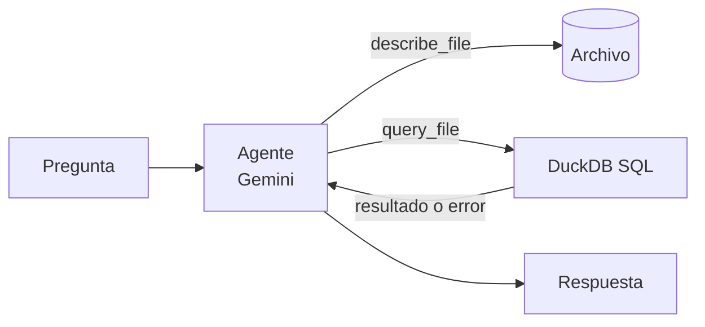
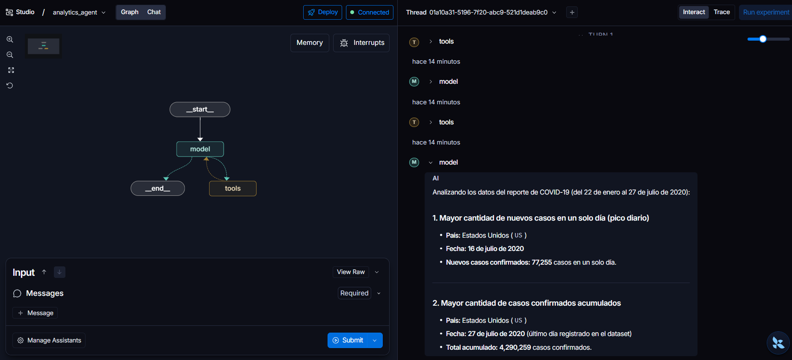
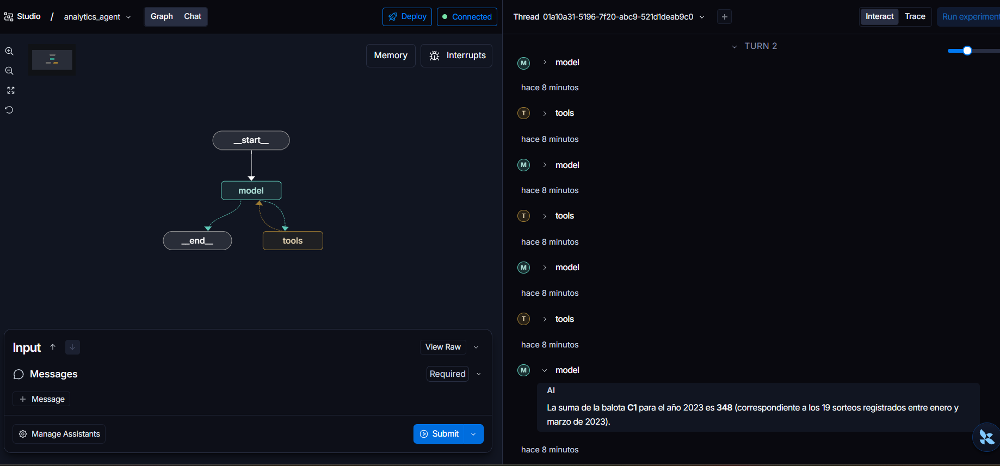

<div align="center">

# Analytics Agent

**Hazle preguntas a tus datos en lenguaje natural.**

Un agente de LangGraph que lee tus archivos, escribe el SQL y te responde con números reales.


</div>

---

```text
Tú:      ¿Qué país tuvo más casos confirmados de COVID-19 y en qué fecha?
Agente:  Estados Unidos, con 4.290.259 casos acumulados el 2020-07-27.
```

El agente explora el archivo, escribe la consulta, la ejecuta con DuckDB y, si falla, la corrige solo. Cada número de la respuesta sale de una consulta real.

## Inicio rápido

```bash
git clone https://github.com/<tu-usuario>/analytics-agent.git
cd analytics-agent

uv venv .venv && source .venv/bin/activate
uv pip install -r requirements.txt

gcloud auth application-default login
langgraph dev
```

Se abre **LangGraph Studio** en el navegador, listo para chatear con el agente.

> Necesitas un proyecto de Google Cloud con Vertex AI habilitado.

## Cómo funciona



| Herramienta | Qué hace |
|---|---|
| `describe_file` | Devuelve las columnas, sus tipos y filas de ejemplo del archivo. |
| `query_file` | Ejecuta SQL sobre el archivo, cargado como la tabla `data`. |

Las consultas corren en una base DuckDB en memoria, sin acceso al disco ni a la red. El agente solo puede leer el archivo que le pides.

## Resultados verificados

Comparamos cada respuesta del agente con el mismo cálculo hecho a mano en el [notebook de análisis](resources/analytics.ipynb).

### COVID-19



| Pregunta | Agente | Notebook |
|---|---|---|
| Mayor total acumulado de casos | US · 2020-07-27 · 4.290.259 | ✅ 4.290.259 |
| Mayor cantidad de casos nuevos en un día | US · 2020-07-16 · 77.255 | ✅ 77.255 |

<details>
<summary>Ver el SQL del notebook</summary>

```sql
-- Mayor total acumulado
WITH db AS (
    SELECT
        strptime(Date, '%Y-%m-%d')::DATE AS fecha,
        "Country/Region",
        SUM(Confirmed) AS casos
    FROM covid_results
    GROUP BY 1, 2
)
SELECT fecha, "Country/Region", casos
FROM db
ORDER BY casos DESC
LIMIT 1;

-- Mayor cantidad de casos nuevos en un día
WITH db AS (
    SELECT
        strptime(Date, '%Y-%m-%d')::DATE AS fecha,
        "Country/Region" AS pais,
        SUM(Confirmed) AS casos
    FROM covid_results
    GROUP BY 1, 2
)
SELECT fecha, pais, casos - LAG(casos) OVER (PARTITION BY pais ORDER BY fecha) AS nuevos
FROM db
ORDER BY nuevos DESC NULLS LAST
LIMIT 1;
```

</details>

### Baloto



| Pregunta | Agente | Notebook |
|---|---|---|
| Suma de la balota C1 en 2023 | 348 (19 sorteos) | ✅ 348 (19 sorteos) |

<details>
<summary>Ver el SQL del notebook</summary>

```sql
WITH db AS (
    SELECT strptime(Date, '%m/%d/%Y')::DATE AS fecha, C1
    FROM results
)
SELECT SUM(C1), COUNT(*)
FROM db
WHERE fecha >= '2023-01-01';
```

</details>

## Usa tus propios datos

1. Copia tu archivo (`.csv`, `.tsv`, `.parquet` o `.json`) en `resources/`.
2. Descríbelo en `FILES`, dentro de [`agent/prompt.py`](agent/prompt.py):

```python
FILES = {
    "ventas.csv": "Ventas diarias por tienda y producto durante 2024.",
}
```

## Estructura

```text
agent/
├── agent.py     # Modelo y definición del agente
├── tools.py     # describe_file y query_file
└── prompt.py    # Prompt del analista y descripción de los archivos
resources/       # Datos de ejemplo y notebook de análisis
docs/images/     # Capturas de LangGraph Studio
langgraph.json   # Configuración de LangGraph
```

## Datos de ejemplo

- `covid_19_clean_complete.csv`: [COVID-19 Dataset](https://www.kaggle.com/datasets/imdevskp/corona-virus-report) en Kaggle.
- `baloto.csv`: resultados de los sorteos del Baloto de Colombia (2017–2023).
